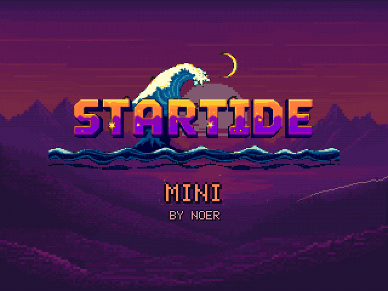
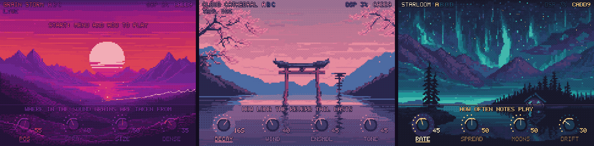
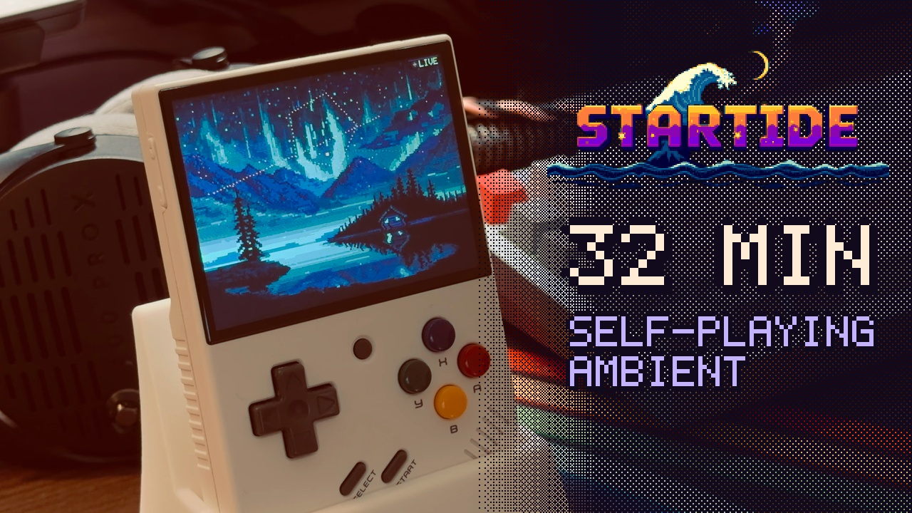
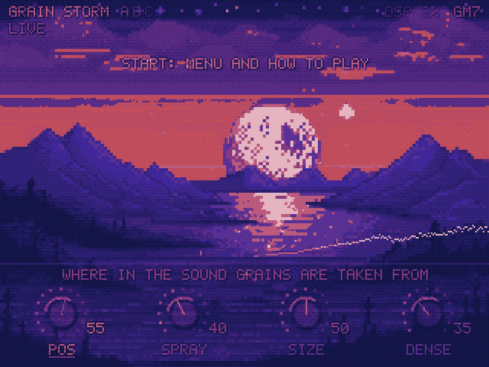
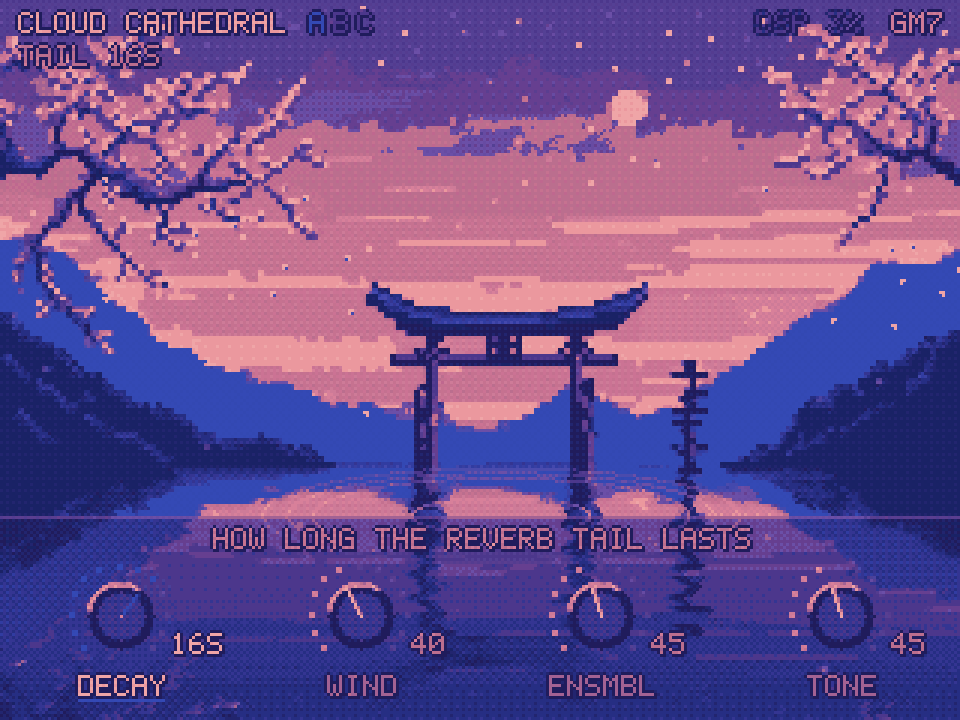
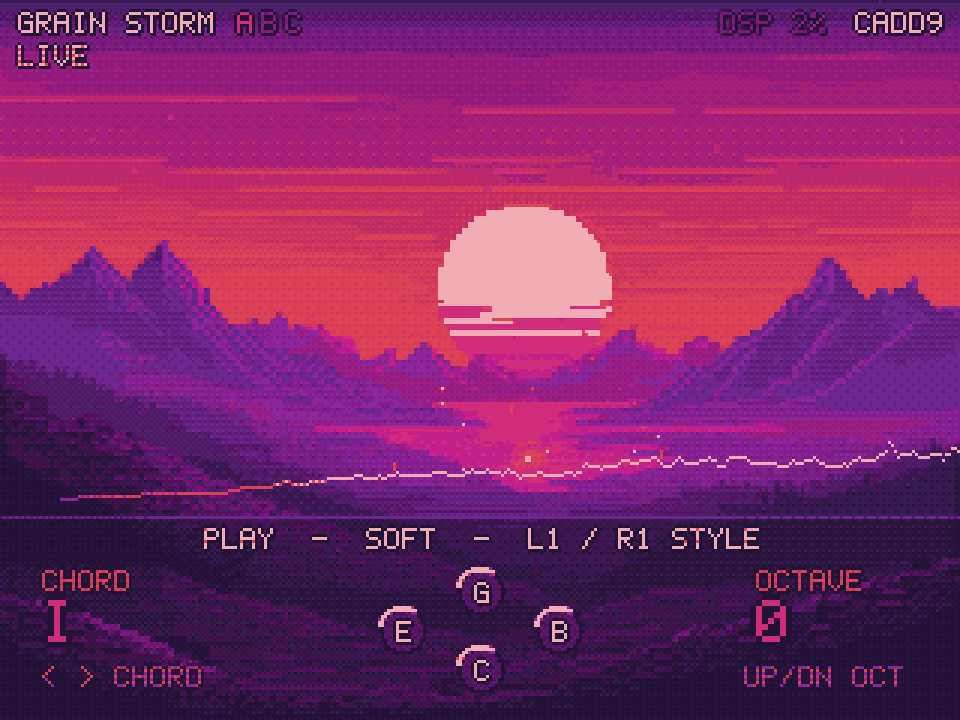
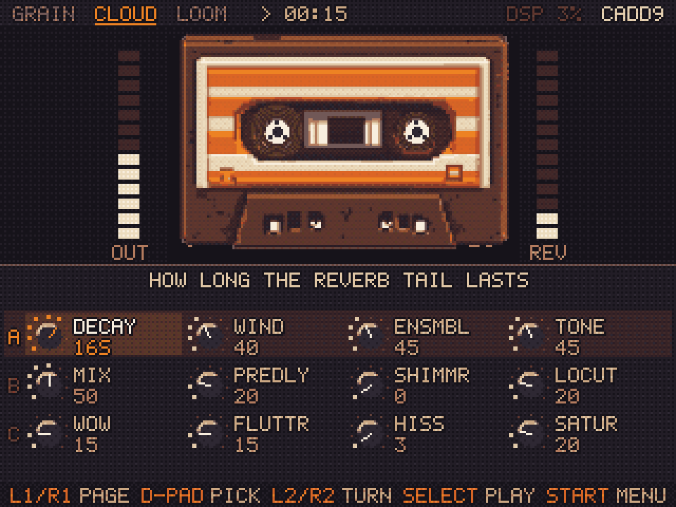
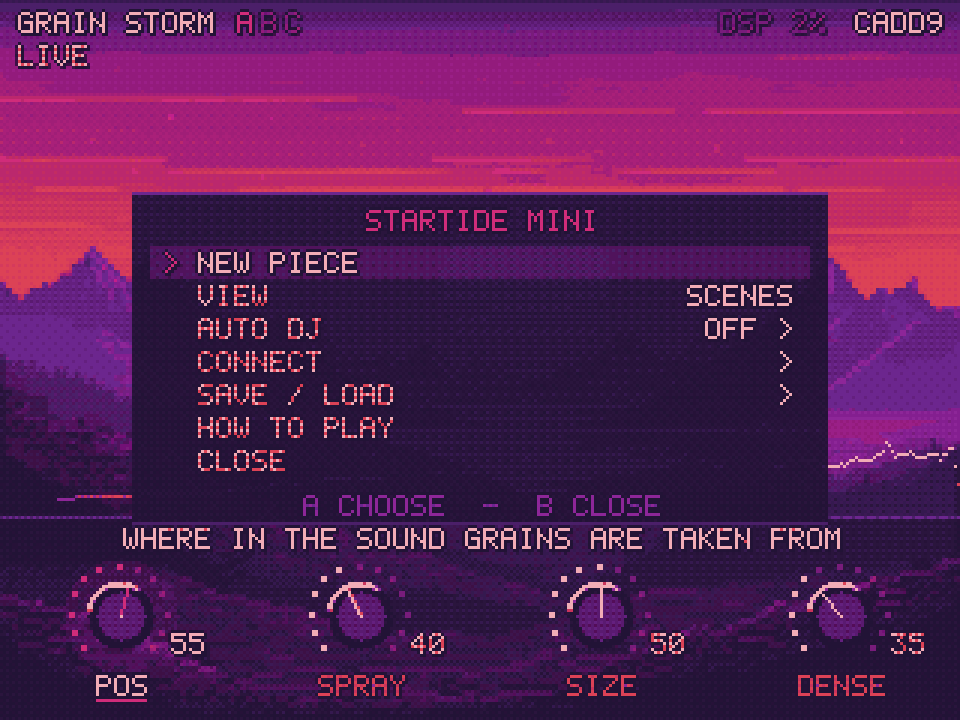
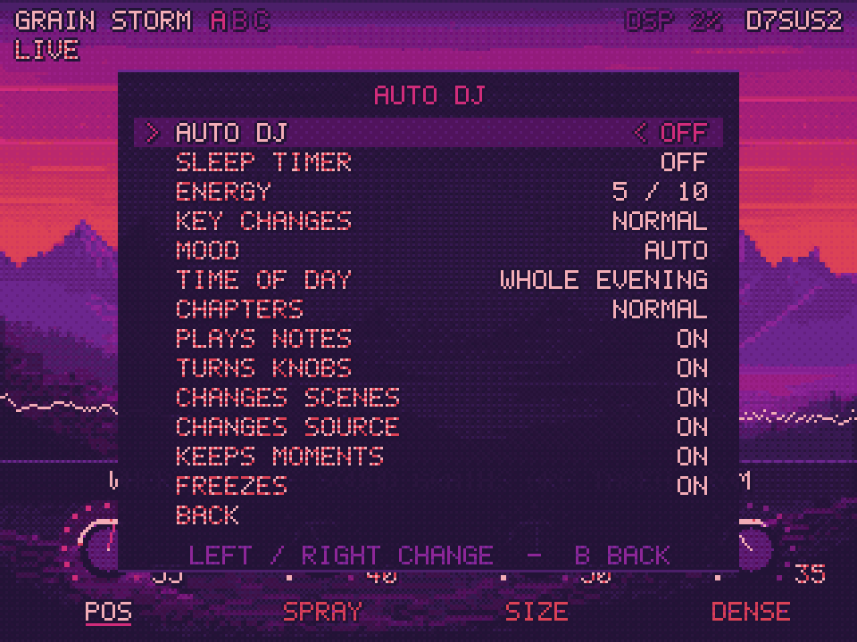

# Startide

**A pocket ambient instrument for the Miyoo Mini and Mini Plus.**
Granular clouds, a cathedral reverb and warm tape, painted as a slow evening in pixel art.
It plays itself, never repeats, and lets you play along.

[**Download**](https://github.com/noerdk/startide/releases/latest) ·
[Install](docs/install.md) ·
[Controls](docs/controls.md) ·
[Updating](docs/updating.md) ·
[FAQ](docs/faq.md) ·
[Changelog](CHANGELOG.md)

---

## Why Startide

Most music on a handheld is something you program. Startide is something you **sit with**.
Turn it on and an evening begins: a drone settles, chords drift through a key, bells fall
into a reverb that lasts for a minute. Every knob reshapes it live, and every button you
press lands in key. Leave it alone and the **AUTO DJ** carries the evening on its own,
from dusk through the night to dawn.

It was made for a device that fits in a pocket and a screen that's 320 pixels wide, and it
is meant to be calm: slow dissolves, soft breathing light, nothing that shakes or flashes.

## See it play

[**32 minutes of Startide playing itself**](https://youtu.be/IoOSsrhl9rQ) · [the Short](https://youtube.com/shorts/Hz4l58kQVew)

## Features

<table>
<tr>
<td width="50%" valign="top">

### 🌄 Three pages, one evening
**Grain Storm** · **Cloud Cathedral** · **Starloom**: each a hand-reworked pixel-art
painting that answers the sound. The sun breathes with the level, petals ride the reverb
tail, every note lights a star. Each new piece picks a different version of each painting:
dusk, blue hour and night; morning mist and moonlight.

### 🎛️ Every knob, live
Up to four banks of four knobs per page: grain position, spray, size and density; a
reverb from 1.5 s to a minute with wind, ensemble, shimmer and low-cut; tape wow,
flutter, hiss and saturation; the mixer; comets; key, scale, octave and how often the
chords move.

### 🎹 Play along, always in key
**PLAY mode** turns A B X Y into the four notes of the current chord. Six ways to hold a
note: soft repeats, held tones, bowed swells, arpeggios, strums and streams of grains.

</td>
<td width="50%" valign="top">

### 🌙 AUTO DJ
The instrument plays itself in chapters with moods (Still Water, Lanterns, Cathedral,
Constellations, Deep, Bloom), moves gently between keys, turns the knobs, and keeps
its best moments as new samples. A sleep timer winds it down and fades it out.

### ✨ Granular from anything
Grains from a rolling recording of the music itself, from the twelve built-in sounds
(felt piano, singing bowl, glass bells, choir, rain on glass…), or from your own WAVs,
always tuned into the music's key.

### 📼 Record, save, resume
Record the last 20 seconds as a new sample, save four snapshots, and pick up exactly
where you left off next time.

### 📡 Wi-Fi MIDI and automatic updates
Play it from a Mac, iPad or DAW over network MIDI. New versions arrive over Wi-Fi:
Startide tells you when one is out and installs it when you say so. (Wi-Fi needs the
Mini Plus: the original Mini has none.)

</td>
</tr>
</table>

## Gallery

| | |
|:---:|:---:|
|  |  |
| **Grain Storm**, moonlit | **Cloud Cathedral**, by moonlight |
|  |  |
| **PLAY mode**: four notes, always in key | **TAPE view**: every knob at once |
|  |  |
| **Start menu** | **AUTO DJ** settings |

## Install

> **You need:** a Miyoo Mini or Mini Plus with [Onion OS](https://onionui.github.io/), and an SD card reader.
> A [MinUI](https://github.com/shauninman/MinUI) package is included too; it hasn't been tried on a device yet, so reports are welcome.

1. **Download** `Startide-Onion.zip` (or `Startide-MinUI.zip`) from the [latest release](https://github.com/noerdk/startide/releases/latest).
2. **Unzip** it to the root of your SD card. It merges into the folders already there (`App/Startide` on Onion).
3. **Start** it from *Apps* (Onion) or *Tools* (MinUI). That's it.

Step-by-step with pictures, updating from an older copy and uninstalling: **[docs/install.md](docs/install.md)**.

## Controls at a glance

| Button | What it does |
|---|---|
| **D-pad** ◀ ▶ | pick a knob |
| **D-pad** ▲ ▼ | turn it (hold to sweep) |
| **L1 / R1** | previous / next page |
| **L2 / R2** | previous / next knob bank |
| **SELECT** | PLAY mode on / off |
| **Y** | freeze (hold the sound still) |
| **A** | grain burst · hold for a swarm |
| **START** | menu: new piece, AUTO DJ, saves, how to play |
| **MENU** (hold) | save and quit |

All of them, PLAY mode included: **[docs/controls.md](docs/controls.md)**.

## Updates

Startide keeps itself up to date. A few seconds after it starts with Wi-Fi on, it checks
this repository for a newer release. If there is one, it says so, and an
**UPDATE TO x.y.z** line appears in the Start menu, right under NEW PIECE. Nothing changes until you
choose it: then every file is downloaded and checked before anything is replaced, and it
restarts into the new version with your session, saves and samples untouched.
More in **[docs/updating.md](docs/updating.md)**.

## FAQ

<b>Does it work on the original Miyoo Mini (not Plus)?</b>

Yes, it's been tested on both. The original Mini has no Wi-Fi, so it doesn't get the
automatic updates or Wi-Fi MIDI: to update it, unzip the new release over the old copy.

<b>Can I use my own sounds?</b>

Yes. Put WAV files in `App/Startide/samples/` and pick them with the SOURCE knob (Grain
Storm, bank B). They're tuned into the music's key automatically; a line in
`samples/keys.txt` tells Startide a file's key if you know it.

<b>The sound crackles or the battery drains fast.</b>

Startide runs the CPU at full speed while it plays; its sound engine uses about 40% of
the time it has for each block of audio, so there's headroom. See
[docs/faq.md](docs/faq.md#performance) for the settings that ease it further.

<b>Where are my recordings and saves?</b>

Recordings are in `App/Startide/samples/` (`REC 001.wav` and on; the AUTO DJ's are
`DJ 001.wav` and on), snapshots in `App/Startide/saves/`, and your session in
`App/Startide/state.txt`. Updates never touch them.

More answers in **[docs/faq.md](docs/faq.md)**.

## Feedback

Found a bug, or have an idea? [Open an issue](https://github.com/noerdk/startide/issues/new/choose).
For a bug, attach the two files in `App/Startide/logs/`: they say which version and firmware
you have, what happened just before, and, if Startide crashed, where.

## Credits

Startide is made by **Noer** · © 2026 Noer Advisory. All rights reserved. See [LICENSE.md](LICENSE.md).

**AI disclosure:** Startide is AI-assisted. Noer designed it, directed it and tested it on a
Miyoo Mini Plus, and much of the code was written with Claude (Anthropic's AI) as a coding
assistant. The paintings and logo were generated with Stable Diffusion XL and the
pixel-art-xl LoRA and FLUX.1 [schnell], then reworked by hand into each scene's palette.
The sounds are all made by the instrument itself; there's no AI audio.

Thanks to the
[Onion](https://github.com/OnionUI/Onion) and [MinUI](https://github.com/shauninman/MinUI)
teams for making the Miyoo Mini such a good place to build for.

 

