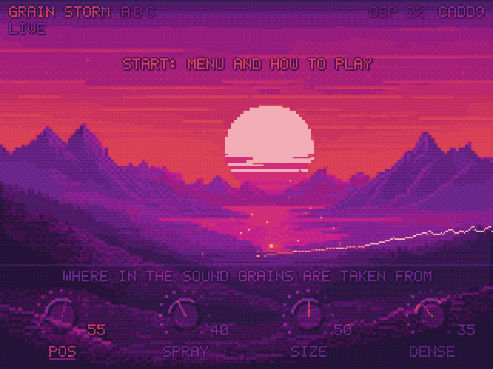
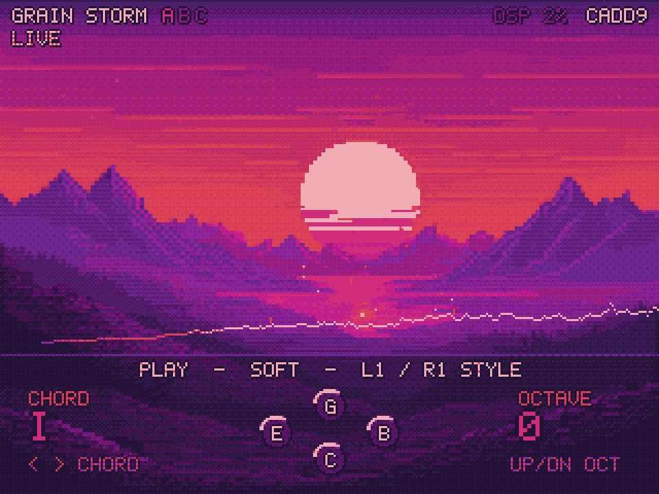
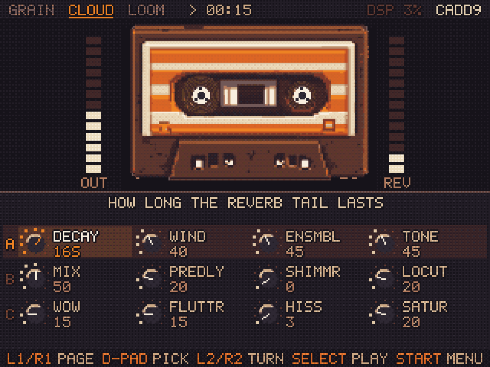

# Controls

[← Back to the README](../README.md)

Startide has two ways of being played: **the knobs** (the default) and **PLAY mode**, where the
face buttons become notes. SELECT switches between them. **START → HOW TO PLAY** shows a tour
on the device itself.

## The knobs

| Button | What it does |
|---|---|
| **D-pad** ◀ ▶ | pick a knob |
| **D-pad** ▲ ▼ | turn it; hold to sweep |
| **B** | reset the selected knob |
| **L1 / R1** | previous / next page (Grain Storm, Cloud Cathedral, Starloom) |
| **L2 / R2** | previous / next bank of knobs on this page (A, B, C, D) |
| **Y** | freeze: the sound holds still, the picture settles; again to let go |
| **A** | a burst of grains; hold for a swarm |
| **X** held + D-pad | scrub live: ◀ ▶ move the grain position, ▲ ▼ the pitch |
| **SELECT** | PLAY mode |
| **START** | the menu |
| **MENU** (hold a moment) | save and quit (a tap just reminds you) |

After 20 seconds without a press, the knobs fade away and only the painting remains. The
first press brings them back without changing anything.

## PLAY mode

The face buttons play the four notes of the current chord, stacked in thirds, so whatever you
press is in key:

| Button | Note |
|---|---|
| **B** (bottom) | the root |
| **Y** (left) | the third |
| **X** (top) | the fifth |
| **A** (right) | the seventh |

| Button | What it does |
|---|---|
| **D-pad** ◀ ▶ | walk to the other chords of the key (shown as I–VII) |
| **D-pad** ▲ ▼ | octave up / down |
| **L1 / R1** | how a held note plays (see below) |
| **L2** | freeze |
| **R2** | a burst of grains; hold for a swarm |
| **SELECT** | back to the knobs |

### Six ways to hold a note

| Style | Press | Hold |
|---|---|---|
| **SOFT** | a bell and a little cloud of grains | it repeats softly, fading |
| **HOLD** | a gentle bell | a sustained tone; fades when you let go |
| **SWELL** | silence at first | a bowed tone slowly blooming in, with vibrato |
| **ARP** | the note | arpeggiates the chord; hold several to weave between them |
| **STRUM** | a rolled chord up from the note | strums again, gentler |
| **GRAIN** | a few grains | a stream of grains at the note, thickening as you hold |

## The menu (START)

| Line | What's there |
|---|---|
| **NEW PIECE** | a fresh piece: new key, new timbres, new paintings |
| **UPDATE TO x.y.z** | only when a new version is out: see [updating](updating.md) |
| **VIEW** | the paintings, or the TAPE view (a cassette and every knob at once) |
| **AUTO DJ** | let it play itself; the sleep timer; what the DJ may change |
| **CONNECT** | Wi-Fi MIDI, MIDI channel, AUTOPLAY, FIT TO KEY |
| **SAVE / LOAD** | record the last 20 s as a sample; four save slots |
| **HOW TO PLAY** | the tour |

## The TAPE view

For playing rather than watching: every knob of a page laid out at once. The D-pad moves
around them, **L2 / R2** turn the selected one (hold to sweep), **L1 / R1** change page.
